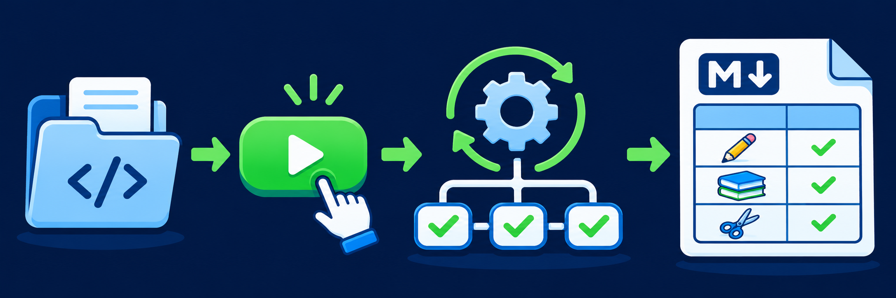

# Mi-GitHub-Actions



## ¿Qué es GitHub Actions?

GitHub Actions permite automatizar tareas en un repositorio de GitHub. Un **workflow** (flujo de trabajo) es un conjunto de pasos que se definen en un archivo. En esta práctica, tú lo inicias al pulsar **Run workflow** y GitHub ejecuta los pasos por ti. [Documentación de GitHub Actions](https://docs.github.com/es/actions/concepts/workflows-and-actions/workflows)

## Práctica: actualizar el README de mi perfil

Hemos creado un workflow para mantener al día la sección **Materiales para el aula** del perfil. Cada vez que lo ejecutas, busca los repositorios públicos con el tema `material-aula`, toma hasta cuatro de los más recientes por fecha de creación y actualiza la tabla del README con sus nombres, enlaces y descripciones.

1. **Etiqueta un repositorio.** En la página de este repositorio en GitHub, abre el engranaje de **About**, añade `material-aula` en **Topics** y guarda. Comprueba que el repositorio sea público.
2. **Prepara el README del perfil.** En `mftienda/mftienda`, coloca estos dos comentarios debajo del título `## Materiales para el aula`. El workflow sustituye el contenido que quede entre ellos.

   ```markdown
   <!-- MATERIALES:INICIO -->
   <!-- MATERIALES:FIN -->
   ```

3. **Localiza el workflow.** El archivo `.github/workflows/actualizar-materiales.yml` debe estar en la rama `main` del repositorio del perfil, `mftienda/mftienda`. Este repositorio, `Mi-GitHub-Actions`, contiene la práctica y puede aparecer como una fila en la tabla. [Ver el archivo del workflow](https://github.com/mftienda/mftienda/blob/main/.github/workflows/actualizar-materiales.yml)
4. **Ejecuta el workflow.** En el repositorio del perfil, abre **Actions → Actualizar materiales para el aula → Run workflow**. Selecciona `main` y confirma con el botón **Run workflow**. [Abrir el workflow en GitHub](https://github.com/mftienda/mftienda/actions/workflows/actualizar-materiales.yml)
5. **Comprueba el resultado.** Cuando la ejecución termine en verde, revisa **Materiales para el aula** en tu perfil. Si la tabla ha cambiado, el workflow crea un commit con la actualización. Si vuelves a ejecutarlo con los mismos datos, conserva la tabla y termina sin crear otro commit. [Abrir el perfil de mftienda](https://github.com/mftienda)

## ¿En qué lenguaje está hecha la tarea?

- **YAML** es el formato que configura el workflow. `workflow_dispatch` habilita la ejecución manual y `contents: write` permite guardar el cambio en el repositorio. [Sintaxis de workflows](https://docs.github.com/es/actions/reference/workflows-and-actions/workflow-syntax)
- **Bash** ejecuta los comandos de los bloques `run:`. Usa `gh api` para consultar los repositorios y `git` para hacer el commit y subirlo cuando cambia el README.
- **Python 3** implementa la lógica de la tarea. Lee los datos de los repositorios, filtra por `material-aula` y genera la tabla Markdown entre los dos comentarios.
